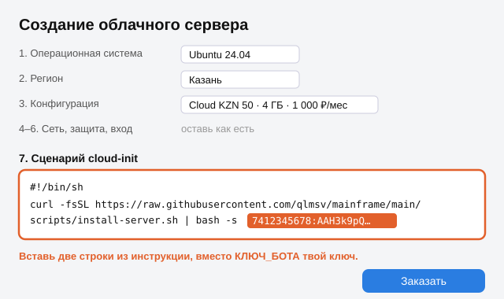

# Установка в России

Всё как в [install-student.md](install-student.md), 4 шага. Здесь один российский сервер и что учесть.

## Сервер: Timeweb Cloud, Казань

| Тариф | Процессор | Память | Диск | Цена |
|---|---|---|---|---|
| **Cloud KZN 50 (советую)** | 2 ядра | 4 ГБ | 50 ГБ | **1 000 ₽ в месяц** |
| Cloud KZN 30 (минимум) | 1 ядро | 2 ГБ | 30 ГБ | 550 ₽ в месяц |

Цены с официального сайта timeweb.cloud на 12.11.2026. Оплата картой или СБП, оплата почасовая, первый платёж от 500 ₽.

1. Зарегистрируйся на **timeweb.cloud**, пополни баланс.
2. «Создать» → «Облачный сервер».
3. Шаг 1: **Ubuntu 24.04**. Шаг 2: регион **Казань**. Шаг 3: **Cloud KZN 50**.
4. Шаги 4–6 не трогай.
5. Шаг 7 **«Сценарий cloud-init»**: вставь две строки из [install-student.md](install-student.md), шаг 2, со своим ключом бота.
6. «Заказать». Через 15 минут напиши своему боту.

## ИИ: китайские модели

Выбираешь в чате с ботом: DeepSeek, GLM, Kimi или Qwen. Ключ берёшь на сайте сервиса:

| ИИ | Где взять ключ | Инструкция сервиса |
|---|---|---|
| DeepSeek | platform.deepseek.com → API keys | api-docs.deepseek.com |
| GLM (Z.ai) | z.ai → API Keys | docs.z.ai |
| Kimi (Moonshot) | platform.kimi.ai → API Keys | platform.kimi.ai/docs |
| Qwen (Alibaba) | modelstudio.console.alibabacloud.com → API Key | alibabacloud.com/help/model-studio |

## Telegram из России

С весны 2026 с российских серверов Telegram для ботов работает с перебоями: в марте 2026 провайдеры начали резать доступ к нему, потом частично вернули. Свежих данных за ноябрь 2026 нет, проверить с российского сервера мы не смогли. В конце установки сервер сам проверяет, открывается ли Telegram, и пишет об этом в журнал.

Если бот не отвечает, есть два пути:
1. **MAX вместо Telegram** (ниже).
2. Сервер в другой стране у того же Timeweb (Амстердам, Франкфурт), но дороже: 2 ГБ за 2 660 ₽ в месяц.

## MAX вместо Telegram

Помощник умеет работать в мессенджере MAX. Ограничение MAX: **бота могут создать только ИП, самозанятые или компании** из России, после проверки через Госуслуги, модерация до 48 часов. Обычному человеку без статуса бот в MAX пока не создать.

1. business.max.ru → Чат-боты → создай бота → после модерации «Настройки» → скопируй ключ.
2. В строке установки вместо ключа Telegram вставь ключ MAX. Помощник сам поймёт, что это MAX.
3. Напиши боту в MAX: настройка такая же, как в Telegram.

Что в MAX работает: настройка в чате, задачи текстом и голосом, ответы (длинные делятся на части), кнопки ответа и копирования, файлы и фото, уведомления, кнопка «Отправить» для писем.

Чего в MAX нет (есть только в Telegram): живого хода задачи, меню и экранов («Сегодня», «Входящие», «Задачи»), виджетов, кнопки пульта. Бот в MAX не может удалить сообщение с ключом, поэтому удали его сам.

## Источники

- Тарифы и регионы Timeweb Cloud: https://timeweb.cloud/services/vds-vps
- Поле cloud-init при создании сервера: https://timeweb.cloud/docs/cloud-servers/manage-servers/create-server
- Telegram API на российских серверах: https://vc.ru/id5779154/2795944-blokirovka-telegram-api-v-rossii
- Боты MAX, кто может создать: https://dev.max.ru/docs/chatbots/bots-create/create/ , API: https://dev.max.ru/docs-api
