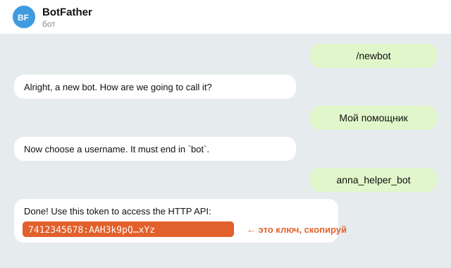
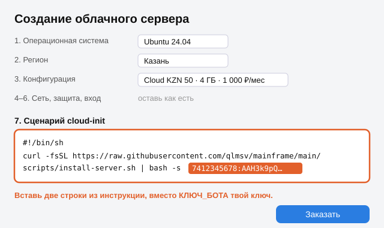
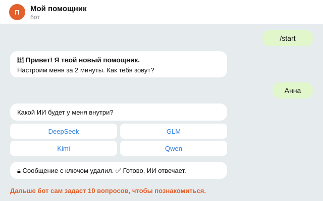

# Как поставить себе ИИ-помощника

Помощник живёт на сервере в интернете и работает круглые сутки. Ты пишешь ему в Telegram текстом или голосом.

Всего 4 шага, около 20 минут. Компьютерные знания не нужны.

**Ты в России?** Открой [install-ru.md](install-ru.md): там российский сервер за 1 000 ₽ в месяц.

## Шаг 1. Создай бота (2 минуты)

1. В Telegram найди **@BotFather**, нажми «Start».
2. Отправь `/newbot`, придумай имя и адрес бота (адрес заканчивается на `bot`).
3. BotFather пришлёт **ключ бота**: длинную строку вида `7412345678:AAH…`. Скопируй её.



## Шаг 2. Возьми сервер и вставь одну строку (5 минут)

Подойдёт любой хостинг, где при создании сервера есть поле для скрипта (оно называется «Cloud-init», «User data» или «Cloud config»). Выбирай **Ubuntu 24.04** и память **от 2 ГБ** (лучше 4 ГБ).

В это поле вставь две строки, а вместо `КЛЮЧ_БОТА` вставь свой ключ из шага 1:

```
#!/bin/sh
curl -fsSL https://raw.githubusercontent.com/qlmsv/mainframe/main/scripts/install-server.sh | bash -s КЛЮЧ_БОТА > /var/log/mainframe-install.log 2>&1
```



Нажми «Создать». Сервер сам всё поставит за 10–15 минут.

## Шаг 3. Напиши своему боту (5 минут)

Через 15 минут открой своего бота в Telegram и нажми «Start». Бот сам проведёт настройку прямо в чате:

1. спросит, как тебя зовут, и часовой пояс (кнопками);
2. предложит выбрать ИИ кнопками: DeepSeek, GLM, Kimi, Qwen или Claude;
3. попросит ключ этого ИИ (где его взять, ниже). Сообщение с ключом бот сразу удалит из чата;
4. проверит, что ИИ отвечает.



Первый, кто напишет боту, становится его хозяином, поэтому напиши сразу. Если бот молчит, подожди ещё 5 минут.

## Шаг 4. Знакомство

Бот задаст около 10 коротких вопросов о тебе и твоих делах. Отвечай как другу, можно голосом. Всё, что расскажешь, он запомнит.

## Где взять ключ ИИ

| ИИ | Где взять ключ |
|---|---|
| DeepSeek | platform.deepseek.com → API keys → Create new API key |
| GLM (Z.ai) | z.ai → API Keys → Create a new API key |
| Kimi (Moonshot) | platform.kimi.ai → Console → API Keys → Create |
| Qwen (Alibaba) | modelstudio.console.alibabacloud.com → API Key → Create API Key |
| Claude по подписке | ключ не нужен: бот пришлёт ссылку для входа, нужна подписка Claude Pro или Max |

Ключ работает, только если на счету у сервиса есть деньги. Поменять ИИ можно потом командой `/model` или в пульте.

## Если что-то не так

- **Бот молчит через 20 минут.** Проверь, что вставил обе строки и свой ключ целиком, выбрал Ubuntu 24.04. Проще всего удалить сервер и создать заново.
- **Хочешь защиту кодом.** Допиши после ключа через пробел любое слово, например `… bash -s КЛЮЧ_БОТА лиса42 …`. Тогда бот станет твоим, только когда ты пришлёшь ему это слово.
- **Ключ бота кто-то увидел.** У BotFather: `/revoke` выдаст новый ключ, старый перестанет работать.

## Для продвинутых

- Установка через терминал: `curl -fsSL https://raw.githubusercontent.com/qlmsv/mainframe/main/scripts/install-server.sh | bash` (спросит всё по ходу).
- Настройка через страницу в браузере: в поле скрипта `curl -fsSL …/install-server.sh | SETUP_CODE="своя фраза" bash -s -- --unattended`, потом открой `https://<IP-с-дефисами>.sslip.io/setup` и введи фразу.
- Режимы «только компьютер» и «сервер + компьютер», Windows: [modes.md](modes.md). Почта и Google: [connectors.md](connectors.md).
- MAX вместо Telegram: [install-ru.md](install-ru.md#max-вместо-telegram).
- Обновление: `bash ~/mainframe/scripts/update.sh`.
