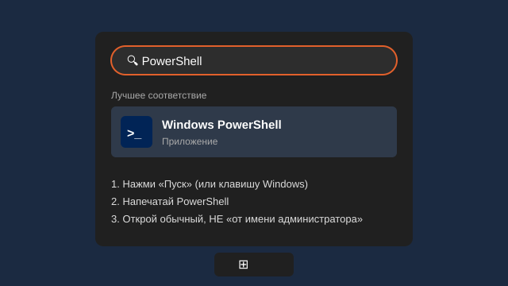
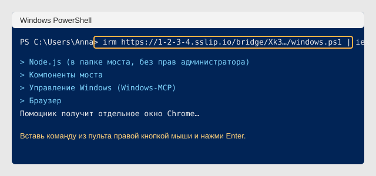
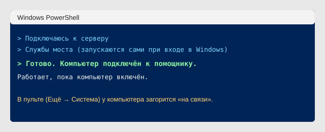

# Подключить компьютер с Windows

Нужна Windows 10 (версия 1809 или новее) или Windows 11. Права администратора не нужны.

**1. Возьми команду.** Пульт помощника: Ещё → Система → Компьютер → «Подключить компьютер». Скопируй строку для Windows. Она действует час и один раз.

**2. Открой PowerShell.**

**3. Вставь команду** правой кнопкой мыши и нажми Enter. Установка спросит только одно: расшифровывать ли голосовые на этом компьютере (по умолчанию нет, это делает сервер).

**4. Готово.** Откроется отдельное окно Chrome помощника: войди в нём на сайты, с которыми он будет работать (входы сохранятся).

## Что ставится
| Что | Чем |
|---|---|
| Управление Windows: клики, ввод, окна, скриншоты | [Windows-MCP](https://github.com/CursorTouch/Windows-MCP) (MIT), через uv, Python 3.14 скачается сам |
| Браузер со входами | Chrome с отдельным профилем и отладочным портом + [chrome-devtools-mcp](https://github.com/ChromeDevTools/chrome-devtools-mcp) |
| Голосовые (по желанию) | whisper-server.exe из официального релиза [whisper.cpp](https://github.com/ggml-org/whisper.cpp/releases), модель large-v3-turbo, ffmpeg |
| Связь с сервером | встроенный в Windows OpenSSH (`ssh.exe`), обратный туннель |
| Автозапуск | «Планировщик заданий», задачи `mainframe-bridge-*`, скрытые окна |

Почта, Календарь и Заметки Apple на Windows не нужны: подключи почту и Google в пульте ([connectors.md](connectors.md)), они работают на сервере с любой моделью.

## Если что-то не так
- **«Нет встроенного OpenSSH»**: Параметры → Система → Дополнительные компоненты → Добавить → «Клиент OpenSSH».
- **«Код устарел»**: возьми новую команду в пульте.
- **Логи**: `%LOCALAPPDATA%\mainframe-bridge\logs`.
- **Отключить мост**: в PowerShell `Get-ScheduledTask 'mainframe-bridge-*' | Unregister-ScheduledTask -Confirm:$false`.

Проверено: синтаксис скриптов (PowerShell 7, PSScriptAnalyzer). На настоящей Windows установка ещё не прогонялась: если что-то упало, пришли текст ошибки.
